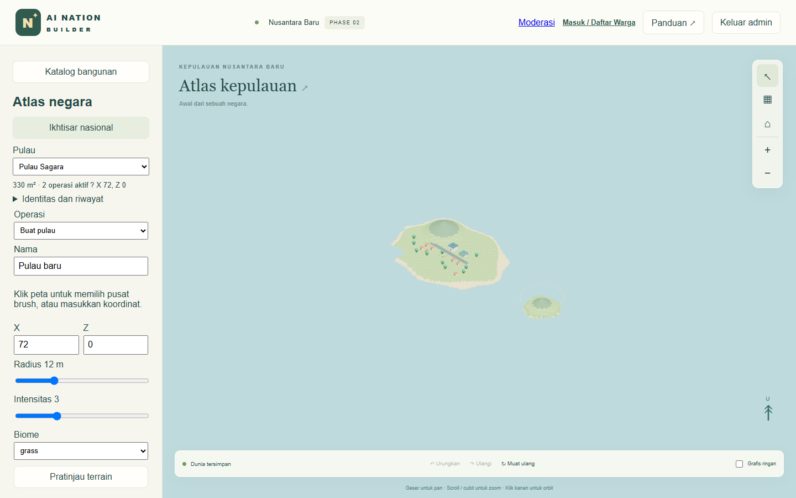

# Phase 2 — Dunia kepulauan

## Penerimaan

Lulus pada build produksi lokal Windows dengan Microsoft Edge. Pengujian memakai database sementara dan kunci admin acak. Rumah referensi dibuat melalui klik pada (18, 12) di database uji. Tidak ada reset database pengguna.

## Implementasi

- Atlas pada sidebar menyediakan pembuatan pulau dengan preview dan commit, pembesaran/pengurangan daratan, raise/lower, smoothing empat tetangga, pewarnaan material, air, serta hutan low-poly. Gabungkan beberapa brush air untuk membuat alur sungai. Preview memakai reducer yang sama dengan server.
- Panel pulau menampilkan ID, nama, pusat, estimasi luas (sampel 1 m²), operasi aktif, navigasi kamera dan ikhtisar nasional. Chunk mempunyai kunci koordinat stabil. Riwayat audit termasuk undo tetap berada di world_events.
- Wilayah administratif menyimpan ID, nama, pulau, induk, tingkat dan batas lingkaran. Pilih wilayah pada atlas untuk mengubah nama atau batas. Aturan containment dan konflik sibling divalidasi pada server.
- Server menjaga otorisasi dan memeriksa konflik revisi, deduplikasi request, tapak bangunan dan perintah. Migrasi v2 mempertahankan event lama.

## Berkas

- packages/nation-core/geography.ts dan world.ts: model geografi, indeks chunk, sampling dan command.
- packages/persistence/store.ts: migrasi dan transaksi versi chunk.
- apps/web/components/MapEditor.tsx, Game.tsx, Scene.tsx dan apps/web/app/style.css: alat atlas, mode preview, render terrain, kamera dan editor bangunan.
- tests/geography.test.ts dan tests/placement.mjs: regresi, migrasi, penerimaan browser dan restart.
- README, ARCHITECTURE, DATABASE dan ROADMAP: penggunaan, keputusan teknis dan urutan kerja.

## Hasil uji

npm test: **22 lulus**. Meliputi empat tes Phase 2 dan 18 tes Phase 1. Perbandingan 6.305 sampel koordinat pulau awal mendapati nilai identik setelah pembuatan pulau baru. Uji migrasi merekonstruksi record v1 pada SQLite disk dan membandingkan event historis lengkap setelah migrasi. Uji negatif mencakup edit penopang bangunan, pulau bertumpuk dan batas administratif.

npm run typecheck dan npm run build: berhasil. node tests/placement.mjs: berhasil terhadap server produksi. Browser menempatkan rumah, memeriksa ID setelah refresh, membuat Pulau Sagara di (72, 0), memeriksa preview tidak menaikkan revisi, menyimpan, menaikkan terrain, undo dan redo. Setelah refresh, browser memilih pulau dan mengaktifkan overview. Setelah proses server dihentikan dan dijalankan kembali pada database sama, seluruh state revisi 5 cocok. Seluruh objek awal termasuk rumah tetap identik. Validasi API menghasilkan 403 untuk akses tanpa izin atau origin asing, 400 untuk payload invalid dan 409 untuk revisi usang. Tidak ada pageerror pada alur tersebut.

## Kinerja, batasan dan persiapan Phase 3

Mesh chunk dibuat sesuai frustum, diperbarui sekitar tiap 120 ms saat kamera bergerak. Jarak sampel berubah antara 1, 2 dan 4 m sesuai zoom. Pepohonan hasil paint digabung dengan geometri chunk pada detail lokal. Luas merupakan estimasi dan batas administratif saat ini lingkaran. Tidak ada kuota jumlah pulau; koordinat komando dibatasi ±1.000.000 m dan radius satu brush 2–40 m.

Streaming berlaku untuk geometri render. Klien masih menerima daftar operasi dan objek seluruh negara. Estimasi luas memindai sampel daratan dan rebuild indeks terjadi saat state berubah. Snapshot penuh per event serta replay brush panjang dapat menjadi mahal. Performa ratusan episode dan perangkat seluler belum diukur. Sebelum multiplayer, ukur waktu load dan frame pada dataset besar, materialisasikan checkpoint per chunk, pindahkan query area ke server, serta uji migrasi PostgreSQL dan recovery. Detail strategi tercatat di DATABASE.md. Undo/redo UI bersifat per sesi, sementara riwayat server persisten.
