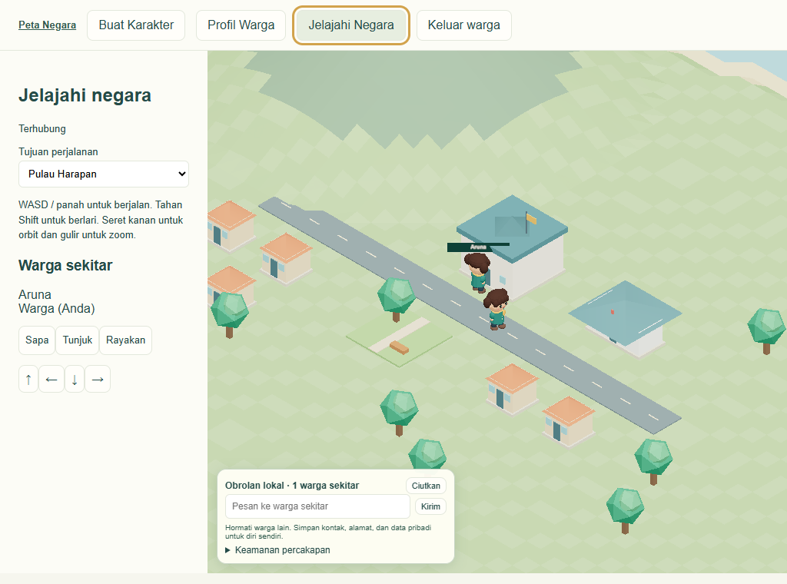

# Phase 3 — Warga Chibi dan multiplayer

**Lulus penerimaan lokal pada 4 November 2026.** Aruna dan Bima memakai akun, cookie dan konteks browser Edge yang terpisah. Keduanya melihat perubahan posisi satu sama lain. Tangkapan layar diambil oleh browser B sebelum A melakukan perjalanan.

## Alur bermain dan arsitektur

Halaman /warga menyediakan registrasi, login, profil privat, editor karakter dan eksplorasi. Avatar memakai komponen kepala, rambut, mata, badan, lengan, kaki dan aksesori. Editor dan dunia memakai komponen Chibi yang sama. Rig prosedural menjalankan idle, walk, run, wave, point dan celebrate. Nama, preset, warna dan pilihan menampilkan nama disimpan dalam versi penampilan. Komponen perender terpisah dari kontrak Look sehingga model GLB kelak dapat memakai preset yang sama.

Next.js menangani akun dan menukar cookie HttpOnly dengan tiket bermain sekali pakai (30 detik). Kata sandi disimpan dengan scrypt dan salt acak. Token sesi disimpan sebagai hash, kedaluwarsa dalam delapan jam, dan dicabut saat logout. Kunci admin dan otorisasi editor tetap terpisah.

Proses Node Colyseus 0.16 menerima input arah dan gestur. Simulasi berjalan 10 Hz, membatasi kecepatan, umur input dan frekuensi pesan, lalu memeriksa daratan, beda tinggi dan footprint bangunan. Klien menginterpolasi pose server. Room negara memakai sel spasial 32 m dan filter jarak aktual (default 180 m) yang melintasi batas sel. Perjalanan memvalidasi tujuan terhadap atlas dan mencari titik aman, menyimpan posisi dan mengganti langganan area dalam koneksi yang sama. Tidak ada avatar pengganti saat menyeberang. Login ganda menggantikan koneksi lama. Setelah putus, klien meminta tiket baru dan masuk kembali dengan identitas tetap. Posisi disimpan tiap sekitar lima detik, saat perjalanan dan saat keluar. Gangguan mendadak dapat mengembalikan pemain ke checkpoint terakhir.

## Data dan migrasi

SQLite WAL tetap menjadi penyimpanan aktif di satu host. Tabel citizens berisi identitas, hash sandi, domisili dan lokasi terakhir; appearances menyimpan riwayat versi. citizen_sessions dan play_tickets bersifat sementara. Akun uji dibuat di database temporer. Dunia utama tidak ditimpa atau diberi pulau uji.

Untuk menyiapkan PostgreSQL, jalankan node scripts/postgres-export.mjs SOURCE.sqlite TARGET.sql. Pilih lokasi privat karena ekspor mencakup hash kredensial. Ekspor mengambil snapshot baca konsisten dan menghasilkan transaksi yang hanya dapat dijalankan ke schema nation_import baru. Sesi dan tiket tidak diekspor. Semua tabel staging memakai RLS deny-by-default. Untuk latihan rollback ganti COMMIT terakhir dengan ROLLBACK sebelum mengeksekusi transaksi. Sumber SQLite tetap tersedia. Setelah impor, bandingkan objek, snapshot, versi karakter, dan revision sebelum merencanakan cutover. Pengujian menggunakan PostgreSQL lokal PGlite. Runtime Supabase Auth, pemetaan identitas Supabase, dan cutover database hosted belum diaktifkan.

## Pengukuran

Dataset sintetis berisi 100 operasi pulau, 1.624 chunk, dan 4.000 objek. Baseline sebelum implementasi pengambilan area: serialisasi penuh 644.932 byte, parse dan indeks 3,43 ms, delta heap Node 1.521.272 byte. Dalam pengukuran akhir, indeks objek server dan query pertama memerlukan 3,73 ms.

| Metrik browser Edge | Dunia penuh | Area pemain |
|---|---:|---:|
| Objek pada payload | 4.000 | 80 |
| JSON tanpa kompresi | 644.932 B | 12.603 B |
| Parse dan pembuatan mesh | 49,6 ms | 2,9 ms |
| Delta heap JavaScript | 5.308.756 B | 218.020 B |
| Waktu render median | 4,1 ms | 0,9 ms |
| Draw calls setelah frustum culling | 40 | 40 |

Reproduksi dengan node scripts/render-benchmark.mjs. Uji render terkontrol memakai mesh kotak, kamera tetap, framebuffer 640 × 400 dan 12 frame terukur setelah pemanasan. Hasil ini mengukur ongkos objek dan transfer area; bukan FPS permainan lengkap. Data geografi masih dikirim sebagai operasi pulau relevan, pemain menerima pembaruan area saat sel atau revisi berubah. Server masih menyimpan state dunia lengkap.

## Verifikasi

- npm test: 25/25 tes lulus termasuk geografi lama, collision, query lintas sel dan validasi penampilan.
- npm run typecheck dan npm run build: lulus. Konfigurasi Next dipindahkan ke next.config.mjs setelah runtime Windows sempat keluar sebelum menerima HTTP.
- node tests/citizens.mjs: dua akun mendaftar, memilih preset, menyimpan dan memuat ulang karakter. Tes memeriksa gerakan dua arah, nama privat, collision balai pada Z −1,6, perjalanan ke Sagara, restart proses multiplayer, login ulang, ID dan penampilan persisten, penolakan mutasi admin 403, serta kesamaan seluruh state negara. Tidak ada pageerror.
- node tests/placement.mjs: rumah (18,12), penempatan lewat viewport, simpan, refresh, sculpt, undo/redo, ikhtisar dan restart produksi seluruhnya lulus.
- node tests/postgres-migration.mjs: impor ke staging PostgreSQL, rollback, kesamaan snapshot dunia dan event, ID warga dan akses SELECT yang tetap difilter RLS lulus.

## Peta implementasi

UI, model dan renderer: apps/web/app/warga, apps/web/components/Citizen.tsx, Explore.tsx, Game.tsx, Scene.tsx, apps/web/app/style.css dan packages/world-engine/Chibi.tsx. API serta domain warga: apps/web/app/api/citizen, packages/citizens/model.ts dan db.ts. Server room dan indeks spasial: apps/multiplayer-server/server.mjs dan packages/multiplayer/spatial.ts. Setup dan dependency: scripts/serve.mjs, package.json, package-lock.json, apps/web/next.config.mjs. Benchmark, migrasi dan tes tersedia di scripts/benchmark.ts, scripts/render-benchmark.mjs, scripts/postgres-export.mjs, tests/spatial.test.ts, tests/citizens.mjs dan tests/postgres-migration.mjs.

## Batas dan persiapan Phase 4

Pengujian memakai satu proses multiplayer, satu host, dua akun dan Edge desktop. Belum ada benchmark beban pemain serentak, uji perangkat sentuh fisik, recovery akun atau deployment publik. Domisili awal Pulau Harapan. Daftar perjalanan berasal dari pulau yang benar-benar tersimpan; Sagara dibuat sebagai fixture di pengujian. Kontrol wilayah administratif belum menentukan hak komunikasi. Query sel tetangga, jarak aktual, identitas sesi dan privasi nama tersedia untuk fase berikutnya. Moderasi, blokir, pelaporan dan otorisasi penerima pesan masih harus dibangun sebelum membuka chat.
