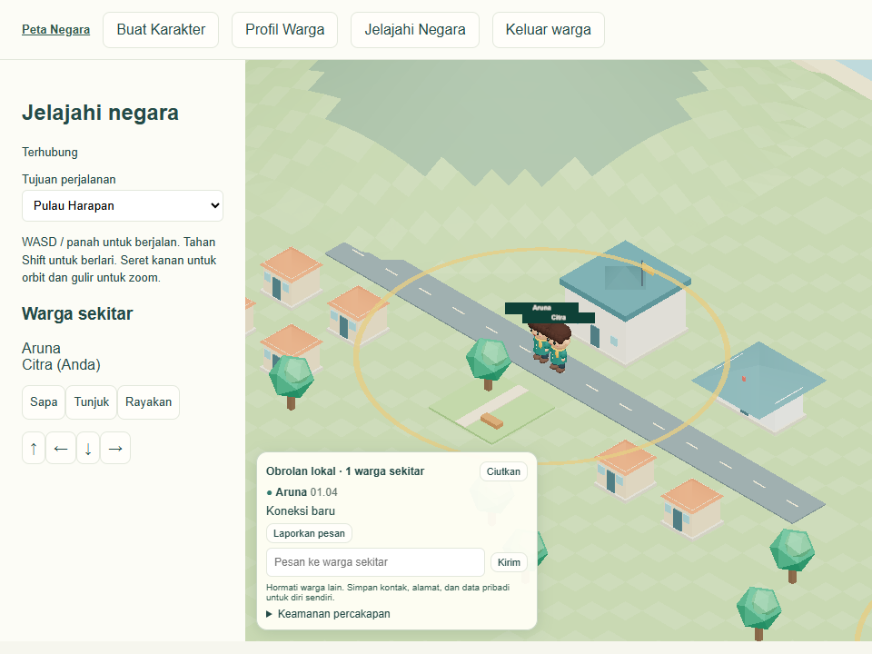

# Phase 4 — Percakapan lokal

**Lulus penerimaan lokal pada 4 November 2026**, dengan tiga akun pada tiga konteks Edge dan server produksi lokal.

## Cara menggunakan

Dua warga dengan sesi dan karakter tersimpan masuk ke Jelajahi Negara. Panel muncul ketika ada warga lain dalam jangkauan. Pengirim mengetik pesan hingga 280 karakter. Panel dapat diciutkan. Nama mengikuti privasi avatar; potret mini memakai warna rambut dan pakaian. Warga dapat membisukan, memblokir dan melaporkan pesan yang diterima. Pengelola membuka Moderasi dari peta setelah login admin.

## Alur pengiriman

1. Colyseus menerima payload yang persis terdiri dari requestId dan text. Identitas dan posisi berasal dari koneksi dan simulasi server.
2. Router memeriksa kepemilikan sesi aktif, masa berlaku sesi, sanksi, dan posisi yang dapat dihuni. Teks dinormalisasi dan diperiksa untuk pola spam, hinaan, kontak, alamat, koordinat serta tautan.
3. Indeks grid 32 m milik room mencari kandidat pada sel sekitar. Jarak horizontal dihitung kembali terhadap posisi aktual. Default chat 120 m dan visibilitas avatar 180 m. Pulau menjadi konteks perjalanan terpisah. Batas administratif di dalam pulau tidak memotong radius.
4. Sebelum pengiriman, server memeriksa sesi, posisi dan preferensi setiap penerima. Mute memutus satu arah dan block dua arah. Server mengirim satu frame ke setiap penerima sah dan satu konfirmasi pesan ke pengirim. Tidak ada kanal broadcast chat.
5. Daftar sekitar diperiksa sekitar empat kali per detik, dan segera ketika mengirim atau berpindah pulau. Hanya perubahan roster/konteks yang dikirim. Pergantian konteks mengosongkan percakapan aktif secara konservatif. Tidak ada backfill. Kehilangan koneksi menghapus panel aktif dan listener mengikuti siklus room.

## Moderasi dan penyimpanan

Server menerima maksimum empat pesan per 10 detik dan 15 per menit per akun. ID replay dan teks terulang ditolak selama 60 detik. Batas berlaku lintas koneksi pada proses yang sama. UI menampilkan teks melalui React tanpa merender HTML kiriman sebagai markup.

Chat biasa tidak masuk ke database. Server menyimpan maksimal 64 bukti pesan masuk per koneksi; laporan dapat dibuat dalam lima menit. Pelapor mengirim ID pesan dan kategori, sementara server mengambil bukti asli dari daftar penerimaan. Tidak ada endpoint riwayat publik. Tabel chat_preferences, chat_reports, chat_sanctions dan moderation_audit ditambahkan tanpa reset. Bukti laporan dipertahankan 30 hari, log tindakan 90 hari. Proses membersihkan saat mulai dan setiap menit saat aktif. Backup dan ekspor memerlukan retensi operasional tersendiri.

Admin dapat menutup laporan, membatasi chat satu jam, atau menangguhkan akun 24 jam. Sanksi akun mencabut sesi. Perubahan laporan, sanksi dan audit tersimpan dalam satu transaksi. Audit mengidentifikasi peran administrator bersama yang digunakan aplikasi saat ini.

## Berkas implementasi

- packages/chat/policy.ts dan storage.ts memuat kontrak pesan, validator, limiter, query spasial, preferensi dan moderasi.
- apps/multiplayer-server/chat.mjs memasang handler room. server.mjs menghubungkannya dengan simulasi, indeks, perjalanan dan cleanup.
- packages/citizens/db.ts membuat tabel tambahan dan memeriksa sanksi akun. scripts/postgres-export.mjs menyertakan data keselamatan dalam staging RLS.
- apps/web/components/LocalChat.tsx dan Explore.tsx menampilkan chat serta mengelola pesan dan konteks. Game.tsx menautkan moderasi. Gaya panel berada di apps/web/app/style.css.
- apps/web/app/moderasi/page.tsx dan api/moderation/route.ts menangani antrean, sanksi dan audit dengan cookie admin serta pemeriksaan origin pada mutasi.
- tests/chat.test.ts, tests/chat-browser.mjs dan scripts/chat-benchmark.ts berisi pengujian dan pengukuran yang dapat diulang.

## Verifikasi lokal

- npm test: 28 lulus. Termasuk batas radius tepat 120 m, penolakan 120,01 m, lintas sel dan region, duplikasi ID/isi, rate limit, preferensi satu dan dua arah, transaksi moderasi, expiry dan retensi.
- npm run typecheck dan npm run build lulus. Uji staging PostgreSQL dan rollback lulus.
- Edge memakai tiga konteks dengan akun terpisah. Aruna mulai pada X −1, Bima X 29, Citra X 499, semua pada Z 0. Dua provinsi berbeda dan dua sel berbeda mencakup posisi Aruna dan Bima. Pesan pertama mencapai Bima sekali. Pemantau frame WebSocket Citra tidak menerima isi pesan tersebut.
- Citra melakukan perjalanan dari Sagara ke pulau awal, kemudian menerima pesan baru. Bima berjalan melampaui radius dan pesan baru tidak masuk ke socket-nya. Panel lama hilang. Sesudah restart Colyseus, percakapan dimulai kosong dan Citra menerima tepat satu frame untuk pesan berikutnya.
- Tes menjalankan alur laporan pada UI, penolakan akses moderator bagi warga, sanksi melalui admin, tiket WebSocket palsu, payload dengan sender/koordinat tambahan, pesan panjang, serta HTML yang tampil sebagai teks.
- Dengan penerima ketiga tetap aktif, frame pembanding mencapai Bima sementara socket Citra tidak mendapat pesan setelah Citra membisukan atau memblokir Aruna. Klien Colyseus autentik yang mengirim UUID ulang atau flood menerima penolakan; pesan terakhir flood tidak mencapai Citra.
- Regresi produksi Edge lulus untuk penempatan rumah (18,12), refresh, atlas, sculpt dan undo/redo, restart, dua akun Chibi, pergerakan dua arah, tabrakan balai pada Z −1,6, perpindahan pulau, logout/login dan izin admin.

## Pengukuran dan batasan

Indeks berisi 20.000 avatar sintetis dengan jarak antaravatar 12 m. Pada 2.000 query radius 120 m, pembangunan indeks memerlukan 6,30 ms. Median query 0,039 ms dan p95 0,060 ms, dengan rata-rata 296 kandidat penerima setelah filter spasial. Angka ini mengukur pencarian lokal, terpisah dari autentikasi database, serialisasi, dan fan-out WebSocket. Satu pesan pendek berukuran 182 byte pada frame aplikasi dalam pengukuran browser lokal. Pada run akhir, waktu dari pengisian dan klik kirim sampai pesan terlihat di browser penerima adalah 165 ms. Pengukuran antarmuka turut mencakup interaksi Playwright dan render.

Pengiriman terbatas pada satu room dan satu proses. Tidak ada routing lintas proses, DM, GPS, atau riwayat publik. Filter konten berbasis aturan dapat meloloskan ejaan yang disamarkan dan dapat menolak teks yang sah. Benchmark indeks tidak menetapkan kapasitas server untuk pengguna serentak. Uji perangkat seluler fisik, beban banyak socket, pengelolaan moderator individual dan operasional moderasi publik masih diperlukan. Phase 5 dapat memakai identitas warga dan pembatasan akun yang sudah tersedia; sistem pemilu belum diaktifkan.
